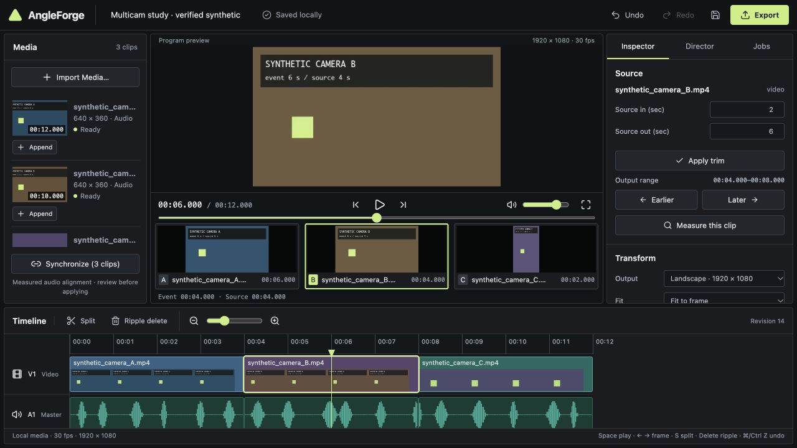

# AngleForge

A local browser editor for turning independent recordings of the same event into one editable multicamera cut. Built with React/TypeScript, FastAPI, SQLite and native FFmpeg. Manual editing works without an AI key. Media is stored on your machine; external AI is an explicit, separately approved action in the Director panel.



## Run on this machine

```sh
python3 run.py --preflight
python3 run.py --open
```

Open **http://127.0.0.1:8766**. The app uses port 8766 because another local application occupied 8765. Stop with Ctrl+C. `Start-AngleForge.command` is the macOS double-click launcher. All media, projects and job records are in the ignored `data/` directory by default. Keep that directory to retain your edits.

## New macOS installation

Requirements: **Python 3.11–3.13**, **Node.js 22.12+ or 24 LTS**, and native **FFmpeg/ffprobe with libx264 and AAC**. Node is needed for building the UI; the built editor runs with Python and FFmpeg. No Docker, CUDA, VM or cloud account.

1. Install [Python](https://www.python.org/downloads/) and [Node.js](https://nodejs.org/en/download).
2. Install FFmpeg with `brew install ffmpeg`, or use a trusted build linked from the [FFmpeg download page](https://ffmpeg.org/download.html). Both executables must be on PATH. Optional `ANGLEFORGE_FFMPEG` and `ANGLEFORGE_FFPROBE` absolute paths can be set in local `.env`.
3. In this folder, run:

```sh
python3 run.py --setup --preflight
python3 run.py --open
```

Setup creates `.venv`, installs the exact Python lock and npm lock, and builds the frontend. If Homebrew reports directory ownership errors, resolve the Homebrew installation yourself or configure private binary paths; AngleForge never changes system ownership. This development machine reused pre-existing private native binaries under ignored `.tools/bin`, which are not redistributed with source.

## Windows installation

1. Install Python 3.13 from Python.org, including the Python launcher, and Node.js 24 LTS.
2. Install a native Windows FFmpeg build from a provider linked by FFmpeg.org. Add the directory containing `ffmpeg.exe` and `ffprobe.exe` to PATH, or set their full paths in `.env`. No WSL or Ubuntu is required.
3. Open a terminal in the project folder:

```powershell
py -3.13 run.py --setup --preflight
py -3.13 run.py --open
```

`Setup-AngleForge.bat` and `Start-AngleForge.bat` are also provided; they use your default Python 3 installation, which must be 3.11–3.13. **Windows execution was not available for this build.** Platform-specific process handling is implemented and reviewed, but is not claimed as runtime-tested.

## First edit

1. Import 3–5 MP4/MOV clips. Originals are copied and preserved; wait for real preparation jobs to finish. WAV/MP3/M4A music imports are supported too.
2. Append a camera from Media to create the initial video track. Click a timeline shot to select it; seek and choose **Split**, trim in the Inspector, move Earlier/Later or **Ripple delete**.
3. Select **Synchronize**, inspect measured offsets/confidence in Director, then apply the proposal. Weak, repetitive or disconnected audio is refused. Use explicit offsets or matching visual anchors when needed.
4. Select a shot and switch its angle from the rail. Unaligned angles and missing coverage are shown; requests outside source coverage are rejected. Choose a master audio source independently.
5. Use **Offline commands** for the documented literal grammar, or configure an external AI provider. Review the proposed changes before applying. Both share one timeline and one undo history.
6. Fit/fill, crop position, landscape/portrait settings, music, gain/mute and short fades are in Inspector. Space plays/pauses, arrows step one output frame, S splits, Delete ripple-deletes, Ctrl/Cmd+Z undoes, Shift+Ctrl/Cmd+Z redoes, Ctrl/Cmd+S saves. Shortcuts do not fire while typing in fields.
7. Choose **Export**, name the MP4 and render. The destination is `data/exports/<export-id>/<filename>`. Jobs provides progress, cancellation, completed destination and download. A file is downloadable only after stream/duration checks and full decode succeed.

Every edit autosaves. Reopen a stored project from the header menu, including after restarting the backend. Exported project JSON is an inspectable document; moving a complete project between machines requires its local media and database directory as well. There is no arbitrary project-file loader or silent missing-media replacement.

## AI providers

OpenRouter is the default runtime adapter; OpenCode Zen supports documented Chat Completions and Responses models, including `muse-spark-1.3`. Coding subagents and runtime model billing are separate.

Copy `.env.example` to ignored `.env` **only when you want to configure a provider**, set the relevant key locally, select a current model ID, and restart the backend. Do not paste secrets into chat, browser settings or project documents. No key is required for import, sync, editing, offline commands, local analysis or export. No live paid inference was used to build or verify this project.

The Director shows the provider/model and selected data before a request. Metadata-only planning sends your instruction and selected-source timeline/metadata. Optional OpenRouter vision sends at most four timestamped JPEG samples per selected clip (up to three clips), after separate consent and verified model image capability. Original video, audio and transcripts are not uploaded. Sparse samples can miss fast action. Zen image capability is not assumed. See [provider configuration, capabilities and budgets](docs/providers.md).

The external director returns untrusted structured proposals; it cannot run a shell, write files, export, upload originals or delete sources. Applying an AI proposal checks its project, exact operations, source ranges and original revision, and records provider/model/usage provenance. A newer manual edit makes a pending proposal stale.

Zen Console service-account keys are supported through its current inference gateway. A live setup check on 2026-10-11 authenticated the key, but Muse Spark Contributor Free returned `FreeTierError`: Zen limits that free tier to the OpenCode app. It did not produce an AngleForge edit. A paid Zen model with available credits or another provider is required for this setup.

## Reproducible synthetic demo

The empty state offers **Load synthetic demo**: three visibly labeled local clips with a 12-second event and offsets 0, 2 and 4 seconds. Their audio is deterministic nonperiodic chirps/noise (seed 74291); camera C is portrait. The demo measures alignment from the resulting audio before constructing a cut.

Generate standalone fixtures for your own tests:

```sh
.venv/bin/python scripts/generate_fixtures.py --output data/fixtures
```

On Windows replace `.venv/bin/python` with `.venv\Scripts\python.exe`. The manifest includes ground truth and a 50 ms acceptance target. Measured error on this macOS run was **0 ms** for all three fixture offsets on a 0.5 ms correlation grid. This is controlled fixture evidence, not a guarantee for arbitrary footage.

## Tests and implementation

```sh
.venv/bin/python -m pytest -q
cd frontend
npm test
npm run build
```

The Python suite includes real FFmpeg imports/renders/decodes, VFR and rotation, source/audio origin, known/ambiguous/disconnected sync, subframe source mapping, gain/fades, process cancellation, restart recovery, atomic publication, stale revisions, undo/redo and scoped access. Provider tests use mocked HTTP responses, including payloads, capability gating, failures and cancellation. Frontend tests verify integer mappings, frame stepping, angle availability, audio gain and signed timecodes. The running editor was also exercised in Codex's in-app browser with Playwright locators; see the [verification report](docs/verification.md).

For frontend development, run the Python backend and `npm run dev` inside `frontend/` (loopback Vite on port 5173 proxies `/api` to 8766). Production serves the built UI from the same Python origin.

- [Architecture and versioned timeline contract](docs/architecture.md)
- [Implementation plan and ownership](docs/implementation-plan.md)
- [Native media/export details](docs/media-pipeline.md)
- [Visual verification ledger](frontend/DESIGN-VERIFICATION.md)

## Deliberate limits

- Captions/transcription, clock-drift correction, dissolves, motion/person tracking, native-video AI analysis and cloud collaboration are unavailable. The UI states these limits; unsupported render effects fail explicitly.
- Portrait reframing is manual fit/fill and crop position, without automated person tracking.
- Two background workers; five uploads per request; 2 GB per file; 50 assets per project. Automatic sync supports up to eight clips and twenty minutes of audio each. Local luma analysis samples at 1 fps for the first ten minutes; contact frames span the clip.
- Proxies use a maximum 960-pixel edge and 30 fps. Output uses declared rational fps; decode tests tolerate at most one output-frame source mapping error. Browser playback is suitable for inspection and can briefly buffer when switching decoders; export is compiled independently from the same document.
- Jobs update through one-second polling. SSE/WebSockets and desktop packaging are deferred.
- No successful live model completion, account-billing test or Windows runtime test was performed. The live Zen setup check was blocked by its free-tier restriction. External AI analysis results are not guaranteed correct; source-bound validation still applies.
